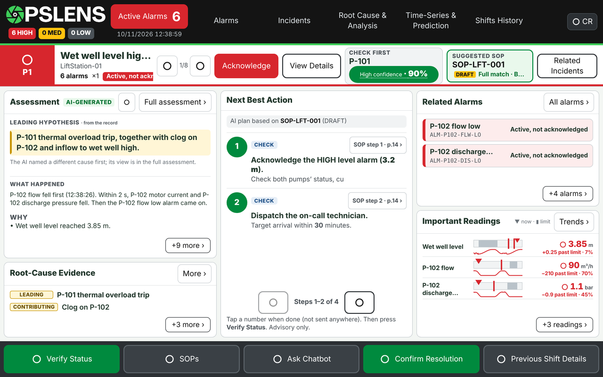
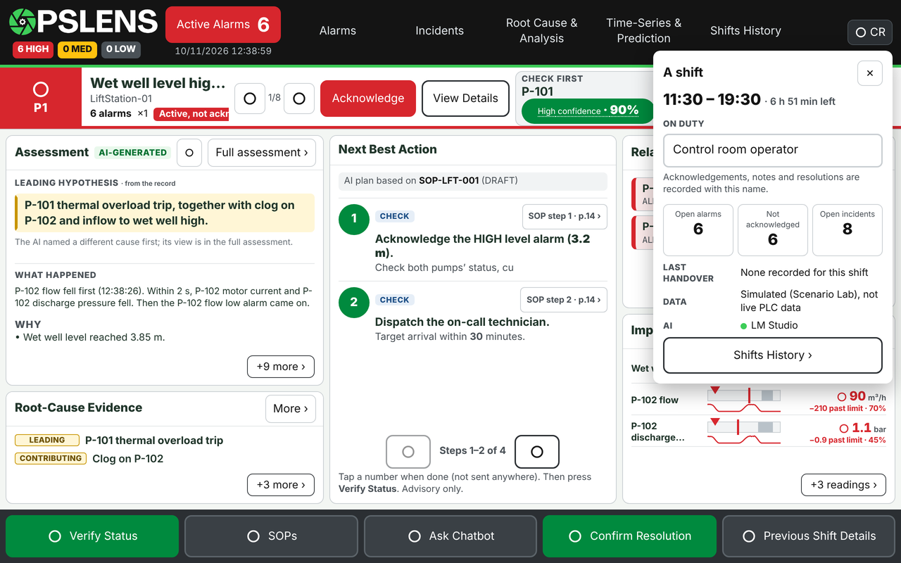
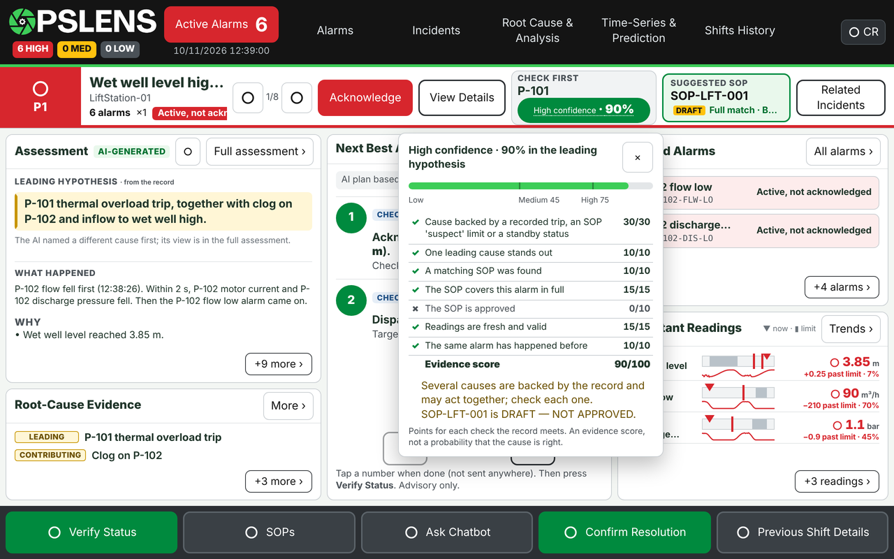
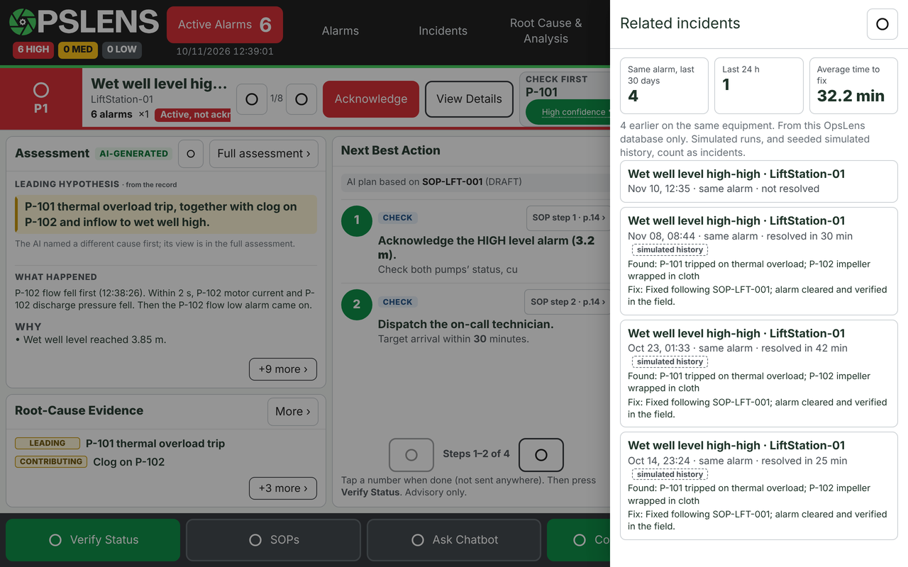
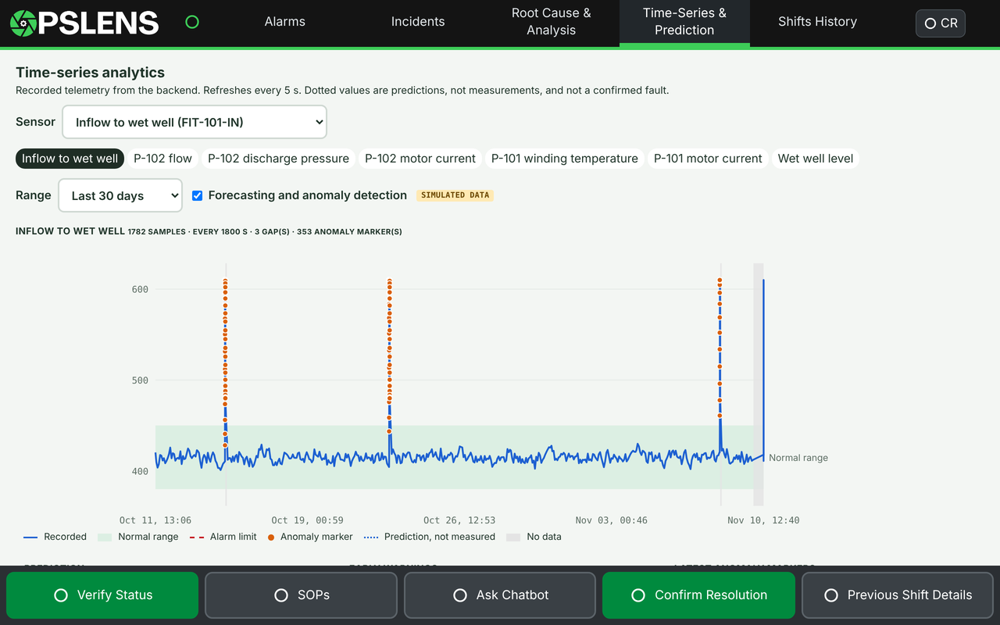

# OpsLens — AI-assisted, evidence-based incident investigation and decision support for wastewater treatment plants

> **Team Sentient Screens** · Winner, Schneider Electric HMI Hackathon (Innovation Marathon), SRM Institute of Science and Technology, 10 September 2026 · Problem statement **PS1 — AI-Powered Runtime Copilot for Industrial HMI**.
>
> OpsLens is a student prototype. It is not a Schneider Electric product and is not deployed at any plant.

An HMI tells the operator *that* an alarm is active. OpsLens reconstructs **the story behind the alarm**: which readings moved first, which equipment is involved, what the plant's SOP says the limits are, how far the process is from the next escalation, which procedure applies, and how the operator will know the problem is fixed — with every number calculated in Python and every procedure step copied verbatim from the cited SOP page.

It is **advisory and read-only**: decision support for the operator, who acts through the plant's existing systems. It never starts or stops a motor, changes a speed, opens a valve, writes a PLC variable or overrides an interlock.

---

## What you see in the demo

The Engineering Console's **Scenario Lab** runs eight incidents. Six come from the plant incident map, with their exact values (normal → alarm/limit → during incident → after fix):

| # | Incident | Equipment · primary alarm | Procedure (SOP-MAN-000 Rev 0, **draft — not approved**) | Coverage |
|---|---|---|---|---|
| 1 | Rags jam the bar screen | InletWorks-01 · `ALM-SCR-110-DL` | SOP-INL-001 Bar Screen Blockage Response | full (gap: no screenings range) |
| 2 | The lift station pumps clog | LiftStation-01 · `ALM-WW-101-HH` | SOP-LFT-001 Lift Station High-High Level and Pump Clog Response | full (gap: no inflow limit) |
| 3 | Nocardia foam on the aeration tank | AerationBasin-01 · `ALM-AER-201-FOAM` | SOP-BIO-001 Activated Sludge Foam Control | full (TSS limits sit in BIO-002) |
| 4 | RAS pump fails, sludge blanket rises | RASSystem-01 · `ALM-SLB-201-HIGH` | SOP-BIO-002 RAS Pump Failure and Sludge Blanket Control | full |
| 5 | CHP engine trips, gas holder fills | BiogasSystem-01 · `ALM-GAS-601-HIGH` | SOP-GAS-001 Biogas Holder High Pressure, CHP Trip and Flare | full (gap: no CHP engine diagnosis) |
| 6 | Centrate poisons the plant inlet | DewateringCentrifuge-01 · `ALM-SLD-701-CAPTURE` | SOP-SLD-001 Dewatering Centrifuge and Centrate Recycle | **partial** — covers centrate as an ammonia load only; nothing on inhibitory/toxic centrate or nitrification inhibition |
| 7 | Low dissolved oxygen due to aeration blower failure | AerationBlower-01 · `ALM-AER-201-DO` | SOP-AER-001 Aeration Blower Failure Response (**separate draft, DRAFT FOR REVIEW — NOT APPROVED**; demonstration limits) | full |
| 8 | UV disinfection intensity low | UVChannel-01 · `ALM-UV-901-INT-LO` | **None.** The manual has no UV disinfection procedure (it names disinfection only in the plant overview and sampling schedule). Shows how OpsLens answers without an SOP. Demonstration values. | none |

The HMI (port 5173) is designed for a **1280 × 800** panel. **Home** has a top bar (logo that opens the Scenarios sidebar, alarm counts by priority, an Active Alarms button, the clock and five tabs), a notification bar for the current incident (severity, title, Acknowledge, View Details, the component to check, the suggested SOP, Related Incidents) and five panels: Diagnosis (the AI's likely cause, why and what is still unknown, then what the record shows), Root-Cause Evidence, Next Best Action (the AI's plan, each step linked to its SOP step with the exact SOP text one tap away; without an SOP, earlier fixes and clearly labelled AI suggestions), Related Alarms and Important Readings. The tabs are Alarms, Incidents, Root Cause & Analysis, Time-Series & Prediction and Shifts History; on them the top bar shrinks to the logo, a Home icon and the tabs. A bottom bar on every screen has Verify Status, SOPs, Ask Chatbot, Confirm Resolution and Previous Shift Details. The likely cause carries an **Evidence Support** score (0–100 %, with Strong ≥ 75 / Moderate ≥ 45 / Limited and a bar); *Why this score?* lists each check and the points it earned. It is a rule-based rating of the evidence in the record, **not a probability**, and is separate from the reading ranking score and the alarm urgency score. An alarm moves from *active, not acknowledged* to *active, acknowledged*, to *condition recovered*, and only then can an operator log it as resolved. Set `OPSLENS_RECOVERY_HOLD_SECONDS` (default 10) for how long inputs must stay clear. Scenario Lab, the procedure library and the alarm reference also stay on the Engineering console (5174).

**AI diagnosis**: Groq (`openai/gpt-oss-120b`, cloud) or a Qwen model in **LM Studio** on this computer (`qwen2.5-7b-instruct`, offline) explains the recorded facts in eight sections: what is happening, evidence, possible causes, recommended checks from the SOP, resolution and recovery check, additional advisory checks, missing information, confidence and limitations. Every answer is checked line by line against the incident record and shows its true source: *AI-generated*, *Deterministic fallback*, *SOP retrieval only* or *AI unavailable*.

| Endpoint | Purpose |
|---|---|
| `GET /api/events/{id}/diagnosis/stream` | SSE: `meta`, `token` (draft), `done` (validated result, latency) |
| `GET /api/events/{id}/brief` | Deterministic operator brief (no LLM) |
| `GET /api/events/{id}/trends` | Incident's own tags with normal band and SOP limits |
| `GET /api/plant/overview` | Monitoring view of all plant tags (not an incident) |
| `GET /api/copilot/ai-status` | Groq or LM Studio status: reachability, model, loaded context, `verified_in_this_process`, `last_diagnosis_call` |
| `POST /api/scenarios/run` · `/stop` · `/corrective-action` | Start, stop, simulate the fix for any unfixed incident |
| `GET /api/telemetry/tags` · `/series` · `/compare` | Recorded series with bands, anomaly markers, data gaps, before/after |
| `GET /api/analytics/forecast` · `/warnings` | Labelled predictions with backtest. Not measurements |
| `GET /api/knowledge-graph?event_id=` | Graph generated from the catalog and the incident record |
| `POST /api/handover/ai-summary` | Model-written shift summary, on request only |



| | |
|---|---|
|  |  |
|  |  |

*Simulated data (Scenario Lab), captured at 1280×800 with a stand-in model.*

OpsLens is read-only: it never writes to a PLC, operates pumps/valves/motors, or acknowledges/clears alarms by itself. Evidence ranking scores are not probabilities.

---

## How a cause is chosen (backend, not scripted)

When an alarm becomes an incident, the backend builds **cause candidates** from the recorded data only: equipment trip/fault inputs, standby equipment that did not start, SOP limits whose action names a cause ("suspect clog"), and readings that moved before the primary alarm. Each candidate is assessed **on its own evidence**:

| Factor | Points |
|---|---|
| Recorded trip or fault status | 25 (standby not started: 15) |
| Changed before the primary alarm | 20 (timing unknown: 5) |
| Size of the deviation | 15 past an SOP limit, up to 10 outside the normal band |
| Other readings agree | 5 each, up to 15 |
| SOP limit with an action exceeded | 10 |
| On the configured path to the alarm (topology) | 10 |
| Earlier incidents with the same cause (defined, **not yet wired**: currently always 0) | 5 |
| Readings that contradict it | −5 each, down to −15 |

Candidates are ordered by points; a candidate first seen **after** the primary alarm cannot lead when an earlier one exists. Roles: **Leading**, **Contributing**, **Related condition**, **Possible consequence**, **Insufficient evidence** (e.g. one abnormal meter while every related reading stayed normal → "check the instrument"). Each candidate carries a ranking note ("65 vs 90 points for P-101 trip: recorded trip or fault (−25)…"). Points are not probabilities.

**Predefined vs computed.** Predefined (configuration): tag names, normal bands, SOP limits and page references, equipment links, which SOP covers which alarm. Computed at run time: every reading, breach, alarm time, event order, candidate, point, role, ranking note, Evidence Support and Next Best Action order. The scenario's injected conditions and its reference outcome are used only by the validation tests and the engineering **Inspector** page (console → Inspector), never by the diagnosis, the AI prompt or the operator HMI. See [docs/VALIDATION.md](docs/VALIDATION.md) for tests A–D (genuine fault, misleading sensor, two competing faults, changed evidence) and all eight scenarios.

## Quick start on Windows (your original laptop)

**Requirements:** Python 3.10+ (3.11 recommended), Node.js 18+ LTS. Optional: LM Studio (or LM Studio Bionic) with Qwen2.5-7B-Instruct, Docker (for Qdrant).

1. Copy the whole `opslens` folder to the laptop (do **not** copy any `.venv` or `node_modules` from another machine — the scripts create them).
2. Double-click **`setup_windows.bat`** (first time only). It creates `edge_intelligence\.venv`, installs Python packages (falls back to `requirements-core.txt` if PyTorch cannot install), runs `npm ci` in `hmi_ui`, and copies `.env.example` to `.env`.
3. Optional — local AI with LM Studio:
   - In LM Studio search **Qwen2.5-7B-Instruct** (lmstudio-community, **Q4_K_M**, not the *Coder* version) and download it.
   - Load it with **Context Length 8192** or more. OpsLens's prompt is 5,000–7,000 tokens and a smaller context cuts it off.
   - Start the **Local Model API** (port 1234). `start_lmstudio.bat`, called by `start_all.bat`, checks this and starts it with `lms server start` when it can.
   - In `edge_intelligence\.env`: `OPSLENS_LLM_PROVIDER=lmstudio`, `EDGE_LLM_URL=http://127.0.0.1:1234/v1` and `EDGE_LLM_MODEL` set to the name LM Studio shows (default `qwen2.5-7b-instruct`).

   Without a local model, OpsLens still runs and labels its answers as not AI-generated. With Groq (`OPSLENS_LLM_PROVIDER=groq`), the LM Studio model is the backup for the diagnosis when Groq cannot be reached.
4. Double-click **`start_all.bat`**. It starts the backend (port 8001), waits for `/api/health`, starts both frontends and opens:
   - Operator HMI — http://localhost:5173
   - Engineering console (Scenario Lab, Procedures, Alarm Reference, Metrics) — http://localhost:5174
5. In the console choose **Lift Station — Wet-Well High-High Level** and press **START SCENARIO**. Switch to the HMI.

Individual launchers: `start_backend.bat`, `start_frontend.bat`. Tests: `run_tests.bat`.

### Manual commands (any OS)

```bat
cd edge_intelligence
py -3 -m venv .venv
.venv\Scripts\python -m pip install -r requirements.txt   :: or requirements-core.txt
copy .env.example .env
.venv\Scripts\python server.py                              :: http://127.0.0.1:8001

cd ..\hmi_ui
npm ci
npm run dev            :: Operator HMI  http://localhost:5173
npm run dev:console    :: Console       http://localhost:5174
```

---

## Configuration (`edge_intelligence/.env`)

| Setting | Default | Purpose |
|---|---|---|
| `OPSLENS_PORT` | `8001` | Backend port (frontends proxy to 8001) |
| `OPSLENS_LLM_PROVIDER` | `lmstudio` in `.env.example`; `none` if unset | `lmstudio`, `groq`, `none`, … (an old `ollama` value is treated as `lmstudio`) |
| `EDGE_LLM_URL` / `EDGE_LLM_MODEL` | `http://127.0.0.1:1234/v1` / `qwen2.5-7b-instruct` | LM Studio's Local Model API and the model name it lists |
| `OPSLENS_LOCAL_TIMEOUT` | `60` s | Read timeout for short local answers |
| `OPSLENS_DIAG_TOTAL_TIMEOUT` / `OPSLENS_DIAG_MAX_TOKENS` | `480` s / `1500` | Limit for one local diagnosis and its length |
| `GROQ_API_KEY` | — | Optional cloud fallback (`OPSLENS_LLM_PROVIDER=groq`) |
| `QDRANT_URL` | `http://localhost:6333` | Optional. Without Qdrant or sentence-transformers, BM25 keyword retrieval is used and reported |
| `OPSLENS_SHIFT_NAME/START/END` | `Night 18:00–06:00` | Shift window for handover |
| `PLC_OPCUA_*` | disabled | Read-only OPC UA client — see [PLC_OPCUA_SETUP.md](PLC_OPCUA_SETUP.md) |
| `OPSLENS_DB_PATH` | `edge_intelligence/opslens.db` | Move the SQLite file elsewhere |

Never put API keys in the frontend or commit `.env`.

---

## Documentation

| File | Contents |
|---|---|
| [ARCHITECTURE.md](ARCHITECTURE.md) | Components, data flow, what is implemented vs. planned |
| [ALARM_CONFIGURATION.md](ALARM_CONFIGURATION.md) | Alarms extracted from the SOP PDF with page references; conflicts with the registry; lifecycle states |
| [PLC_OPCUA_SETUP.md](PLC_OPCUA_SETUP.md) | Connecting the read-only OPC UA adapter to the lab's M241/M251 PLC |
| [TROUBLESHOOTING.md](TROUBLESHOOTING.md) | Ports, LM Studio, Groq, Qdrant, "temporarily unavailable", 409, etc. |
| [CHANGELOG.md](CHANGELOG.md) | Bugs found, bugs fixed, schema/migration notes |
| [TEST_REPORT.md](TEST_REPORT.md) | What was tested, results, and what still needs the real laptop / lab |
| [docs/DEMO_SCRIPT.md](docs/DEMO_SCRIPT.md) | 10-minute presentation walkthrough and Q&A preparation |
| [docs/VALIDATION.md](docs/VALIDATION.md) | Validation tests A–D and the 8 scenarios: injected conditions, expected vs computed ranking |
| [docs/SCENARIOS.md](docs/SCENARIOS.md) | The 8 scenarios: alarms, equipment, readings, limits, deviations, SOP coverage |
| [PROJECT_WALKTHROUGH.md](PROJECT_WALKTHROUGH.md) | Original study guide (pre-v2) |

## Repository layout

```text
opslens/
├── edge_intelligence/          FastAPI backend (Python)            ← active
│   ├── config/alarm_reference.json   alarms from SOP-MAN-000, page-cited
│   ├── alarm_config.py               tag classification, SOP limit checks, conflicts
│   ├── operator_brief.py             deterministic 8-part brief
│   ├── sop_steps.py                  verbatim numbered steps from the PDF
│   ├── api/routes.py, api/copilot_routes.py
│   ├── sop_documents/ingested_pdfs/  SOP-MAN-000 (the plant SOP manual PDF)
│   └── tests/                        348 automated tests
├── hmi_ui/                     React + Vite operator HMI (5173) and console (5174)   ← active
├── setup_windows.bat · start_all.bat · start_backend.bat · start_frontend.bat · run_tests.bat
├── docker-compose.yml          optional Qdrant
└── docs/                       demo script, mentor checklist, analytics notes, SOP-AER-001 draft, screenshots
```

## License

MIT
